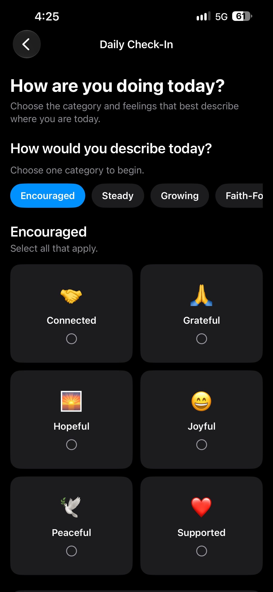

# Learning the Workflow: Git, GitHub, and Building HopeLine

**October 31, 2026**

Today was one of those development days where the biggest accomplishment was not necessarily adding a major new feature. Instead, I gained a much better understanding of how my project is organized and how Git fits into my workflow.

While working on HopeLine, I ran into trouble when I tried to commit and push changes to GitHub. At first, it felt like something was wrong with Git, but after working through the problem, I realized the issue was related to how I was opening the project.

My HopeLine repository contains more than just the iOS application. The root of the repository also contains my README, GitHub Pages files, blog posts, and images. The actual Xcode project is located inside its own HopeLine folder.

That distinction finally clicked today.

When I am working on the HopeLine application, I can open the project in Xcode and focus on the code. When I am working on my development blog, README, images, or other GitHub Pages content, I need to work from the root of the cloned repository.

Once I understood that structure, I was able to get everything working correctly. I committed my changes, pushed them to GitHub, and confirmed that they appeared in the repository. My GitHub Pages deployment also completed successfully.

Another important part of the workflow finally made sense today. When I finish making changes locally, I stage and commit those changes and then push them to GitHub. If I make changes to my GitHub Pages site directly through GitHub afterward, those changes now exist on the remote repository but not in my local copy. Before I continue coding in Xcode, I pull the latest changes so my local project is caught up with GitHub. Understanding the difference between stage, commit, push, and pull helped the entire workflow finally come together for me.

It may seem like a small victory, but this was an important hurdle for me. Git and project organization can become confusing when several parts of a project live inside the same repository. Instead of giving up or assuming something was broken, I slowed down, figured out what was happening, and learned how my repository actually works.

## Building the Daily Check-In

After getting the Git workflow figured out, I was able to move forward with another important part of HopeLine: the Daily Check-In.

I started by creating `CheckInView` and connecting it to the Daily Check-In button on the HopeLine home screen. The first version was intentionally simple so I could make sure the navigation and basic interface worked before connecting everything to the backend.

Once that foundation was working, I created the mood models and `MoodService` to connect the Check-In feature to Supabase. Instead of hard-coding a small list of moods into the application, HopeLine now loads the mood categories, names, and emojis from the database.

The Check-In now allows the user to choose a category and then select multiple feelings that apply. This is especially important for HopeLine because recovery and mental health are rarely described by only one feeling. The mood system includes categories focused on recovery, mental health, faith, growth, encouragement, struggling, and staying steady.

Getting the interface working was only part of the challenge. When I first connected the mood data, the Check-In could not load the moods from Supabase because Row Level Security was enabled without the policy needed to read them. After fixing that, the moods loaded correctly.

I ran into another Row Level Security issue when I tried to save my first Check-In. The main Check-In could be created, but Supabase prevented the selected moods from being saved. I created a policy that allows an authenticated user to save mood selections only when they belong to that user's Check-In.

After adding the policy, I tested the feature again and it worked. My Check-In and multiple selected moods were successfully saved to Supabase.

Seeing the Daily Check-In working from the interface all the way through to the database was a big milestone. HopeLine is beginning to move beyond project structure and planning into an application with real features, real user data, and a backend that is working with the iOS application.

---

## Navigation

- [Home](../index.md)
- [October 27, 2026 - Starting the Journey: Why HopeLine Matters](./2026-10-27.md)
- [November 3, 2026 - Building Reflection and Community into HopeLine](./2026-11-03.md)
- [November 4, 2026 - Building a Location-Aware Recovery Meeting Finder](./2026-11-04.md)
- [November 5, 2026 - From Sample Data to 23,745 Real Meetings](./2026-11-05.md)
