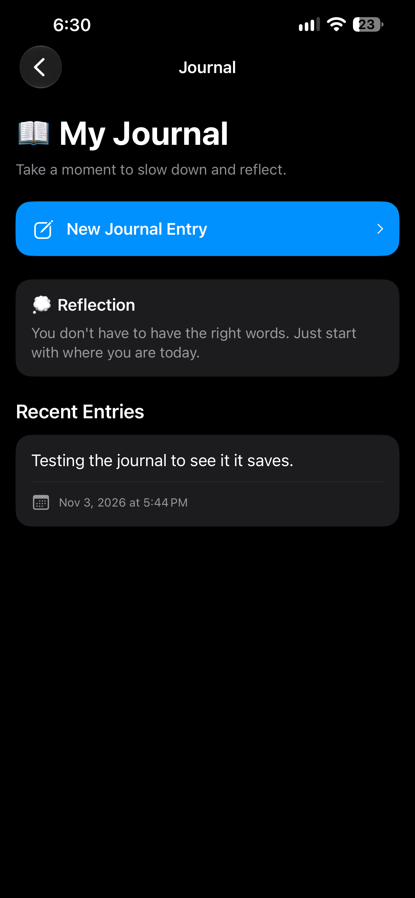
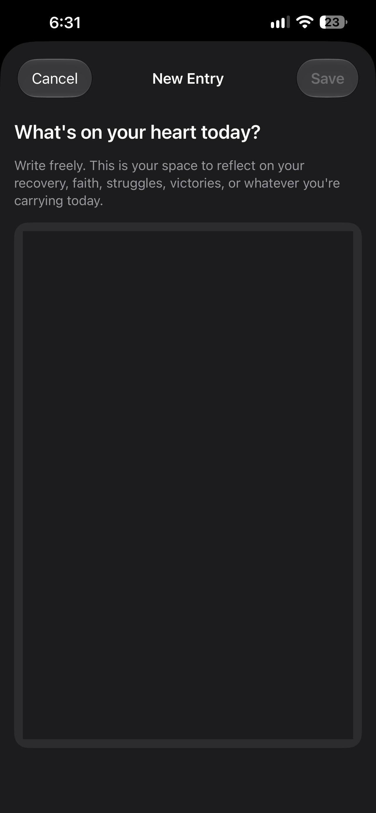
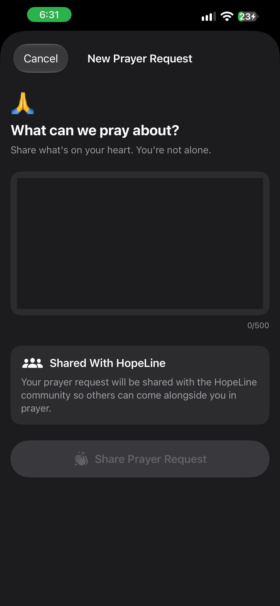
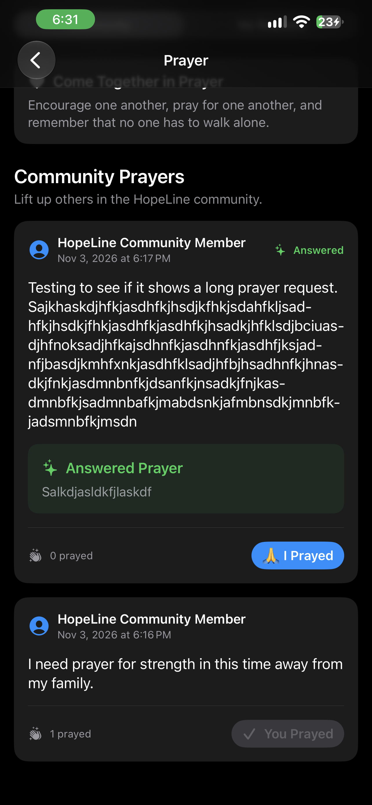
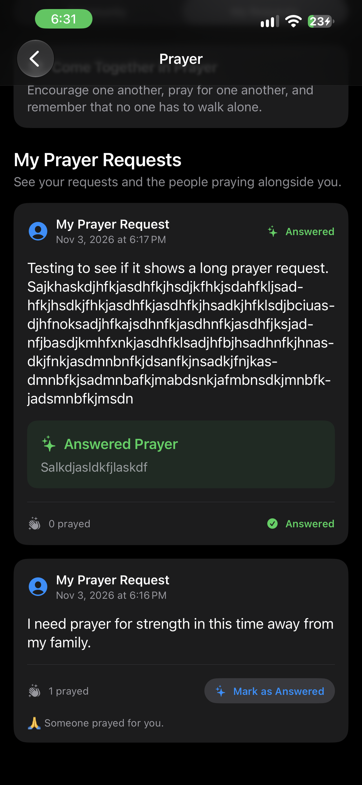

# Building Reflection and Community into HopeLine

**November 3, 2026**

**Author: Brandy Schreckhise**

---

Today was a major step forward in the development of **HopeLine**. Instead of simply building more screens, I focused on turning two important parts of the application into functional features: the **Journal** and **Community Prayer**.

HopeLine is being built as a recovery-support application centered around the idea that support should be available when it matters most. As I continue developing the project, I want each feature to have a clear purpose instead of simply adding more options to the application.

Today, that meant creating one space for personal reflection and another for community support.

---

## 📖 Building the Journal

The first major feature I worked on today was the Journal.

The goal was to create a private space where someone can slow down and write about recovery, faith, struggles, victories, or whatever they may be carrying that day.

  

The Journal screen includes a reflection prompt, a button for creating a new entry, and a Recent Entries section for previously saved reflections.

I also built the New Journal Entry screen with a large writing area that gives the user room to write freely without introducing unnecessary distractions.

  

The biggest accomplishment was connecting the Journal feature to Supabase.

Journal entries are now associated with the authenticated user, saved to the database, retrieved when the Journal screen loads, and displayed in the Recent Entries section.

This was an important milestone because the Journal is no longer just a UI prototype. Data can now move from the SwiftUI interface into Supabase and back into the application.

---

## 🙏 Turning Prayer into a Community Feature

After completing the basic Journal flow, I moved on to Prayer.

While designing this feature, I realized I did not want Prayer to become another version of the Journal. The two features needed different purposes.

The Journal is a space for personal reflection.

Prayer is about saying, **"Please walk with me."**

That idea changed the direction of the feature.

Instead of creating a private prayer list, I redesigned Prayer as a community-centered experience where HopeLine users can share requests and support one another.

The New Prayer Request screen gives users a straightforward place to share what is on their heart. The interface also clearly explains that the request will be shared with the HopeLine community.

  

Once submitted, a prayer request becomes part of the Community Prayers feed.

  

Community members can select **🙏 I Prayed**, which records that someone prayed for the request.

The application remembers that response and displays **You Prayed** afterward instead of allowing the same user to repeatedly increase the prayer count.

This required more than changing the interface. I created a separate prayer-response relationship in Supabase so individual prayer interactions could be stored and connected to the appropriate prayer request.

---

## ✨ Recognizing Answered Prayers

One of my favorite additions today was the **Mark as Answered** feature.

The My Requests section gives users a place to see their own prayer requests along with how many people have prayed with them.

  

When something changes, the person who created the request can mark the prayer as answered.

They can also optionally write what happened.

The answered prayer is then visually highlighted so it becomes more than an old request. It becomes a record of something that changed.

I really like what this adds to HopeLine. The feature is not only about asking for help. It creates an opportunity to return later and recognize progress, answered prayers, and moments when the community came alongside someone.

---

## 🛠️ What I Worked With Today

Today's development included:

- SwiftUI navigation and interface development
- Reusable SwiftUI components
- Async/await
- Supabase authentication
- PostgreSQL database tables
- Row Level Security policies
- User-specific data
- Database inserts, queries, and updates
- Community prayer responses
- Persistent prayer counts
- Answered-prayer updates
- Loading, empty, and error states
- Pull-to-refresh
- UI state management

I also encountered several Swift compiler errors while developing these features.

One involved conditionally applying two different SwiftUI button styles. Another happened because a new service function had accidentally been placed outside of the `PrayerService` class.

Working through those problems reinforced something that has been happening throughout this project: I am getting better at slowing down, reading what the compiler is actually telling me, finding the source of the problem, and correcting the structure instead of randomly making changes.

---

## 💡 What I Learned

Today's biggest lesson was that building a feature is about more than making a screen look right.

The Journal screen looked complete before Supabase was connected, but it did not become truly useful until an entry could be saved, retrieved, and displayed again.

The same thing happened with Prayer.

The **I Prayed** button initially worked visually, but its state disappeared because nothing was being stored. Connecting that interaction to Supabase transformed it from a visual demonstration into actual application behavior.

That distinction between **UI state and persistent application data** is becoming much clearer to me as HopeLine grows.

I am also beginning to see how decisions at the database level affect the experience inside the application. Authentication, user IDs, relationships between tables, and Row Level Security are not separate from the interface. They are part of what makes the interface trustworthy and functional.

---

## 🚀 Where HopeLine Stands

At the end of today's development session, HopeLine now has several pieces working together:

- User authentication
- Daily recovery check-ins
- Journal entries stored in Supabase
- Community prayer requests
- My Prayer Requests
- Prayer-response tracking
- Persistent **I Prayed** interactions
- Prayer counts
- Answered-prayer tracking

But today's work makes HopeLine feel less like a collection of screens and more like a connected application.

That is progress I am proud of.

---

## Navigation

- [Home](../index.md)
- [October 27, 2026 - Starting the Journey: Why HopeLine Matters](./2026-10-27.md)
- [October 31, 2026 - Learning the Workflow: Git, GitHub, and HopeLine](./2026-10-31.md)
- [November 4, 2026 - Building a Location-Aware Recovery Meeting Finder](./2026-11-04.md)
- [November 5, 2026 - From Sample Data to 23,745 Real Meetings](./2026-11-05.md)

---

**Brandy Schreckhise**  
**Full Sail University – Software Development**
