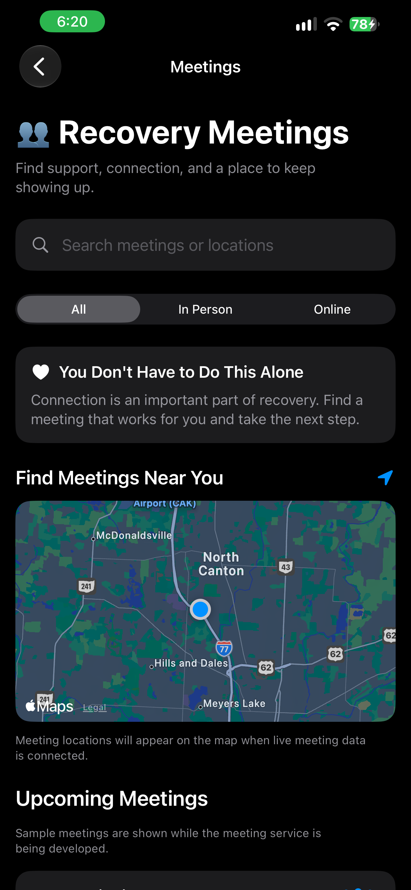

# Building a Location-Aware Recovery Meeting Finder

**November 4, 2026**

**Author: Brandy Schreckhise**

---

Today I continued development on **HopeLine** by moving into another important part of the application: **Recovery Meetings**.

After getting the Journal and Community Prayer features working, I wanted to begin building a way for someone using HopeLine to find recovery meetings when they need in-person or online support.

The basic idea sounds straightforward:

> Use the phone's current location to help someone find recovery meetings nearby.

The interface and location functionality came together well. The bigger challenge turned out to be finding the right source for reliable meeting data.

---

## 👥 Building the Recovery Meetings Screen

I started by creating `MeetingsView.swift` and connecting the Meetings card on the HopeLine Home screen to the new view.

My goal was to keep the Meetings screen consistent with the rest of HopeLine while giving users several ways to find the support they need.

The current screen includes:

- Meeting search
- **All**, **In Person**, and **Online** filters
- A MapKit map
- Upcoming meeting cards
- Meeting day and time
- Meeting locations
- **Details** buttons
- **Directions** for in-person meetings
- **Join** for online meetings

<p align="center">
  
</p>

The screen currently uses sample meeting records while I work through the external meeting-data integration.

That is intentional.

Rather than connecting HopeLine to the first data source I could find, I wanted to establish the architecture and make sure the feature could support the experience I actually want to build.

---

## 📍 Using the Phone's Location

One requirement became very important while planning this feature:

**HopeLine should not be tied to one city.**

Originally, I could have connected the application to meeting information around my local area and called the feature complete.

That would work locally, but it would create a significant limitation.

If someone traveled to another city or state, HopeLine should not continue showing meetings from the previous location.

The application should adapt to wherever the person currently is.

To begin solving that problem, I created a new `LocationService.swift` using Apple's Core Location framework.

HopeLine now requests location permission while the Meetings feature is being used.

The permission message clearly explains why the application needs access:

> **HopeLine uses your location to find recovery meetings near you.**

After permission is granted, HopeLine receives the device location and automatically centers the MapKit map around it.

This allowed me to remove the hard-coded coordinates I originally used while building the screen.

The device now determines where the map starts.

---

## 🗺️ Preparing MapKit for Real Meetings

Adding MapKit gives the Meetings feature the foundation it needs for actual nearby meeting locations.

The current map already follows the phone's location.

Once live meeting data is connected, the goal is for HopeLine to display nearby in-person meetings directly on that map.

The intended flow is:

```text
Phone Location
      ↓
LocationService
      ↓
Nearby Meeting Data
      ↓
MeetingService
      ↓
MeetingsView
   ↙         ↘
Map          Meeting List
 ↓
Directions
```

---

## Navigation

- [Home](../index.md)
- [October 27, 2026 - Starting the Journey: Why HopeLine Matters](./2026-10-27.md)
- [October 31, 2026 - Learning the Workflow: Git, GitHub, and HopeLine](./2026-10-31.md)
- [November 3, 2026 - Building Reflection and Community into HopeLine](./2026-11-03.md)
- [November 5, 2026 - From Sample Data to 23,745 Real Meetings](./2026-11-05.md)
