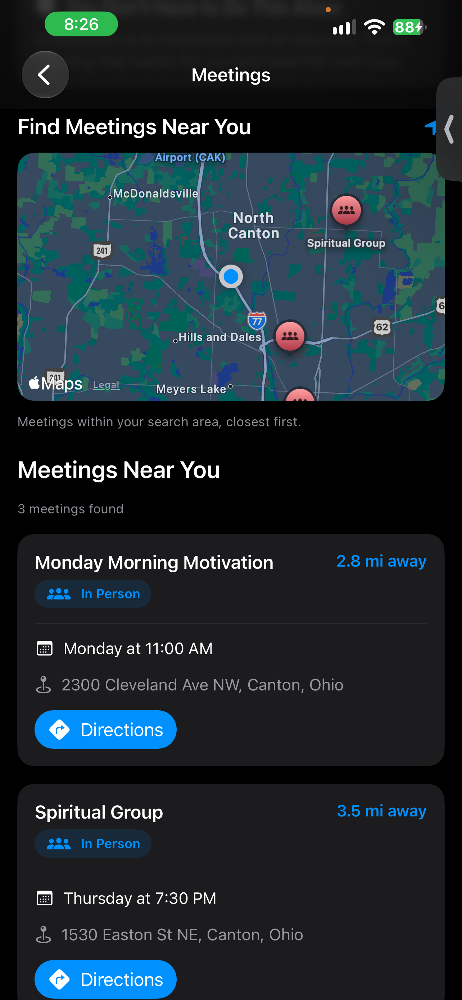

# From Sample Data to 23,745 Real Meetings

**November 5, 2026**

**Author: Brandy Schreckhise**

---

Yesterday's blog post ended with the Recovery Meetings screen running on sample data. The architecture was ready. The screen was ready. The only thing missing was real meeting data.

Today, that changed in a big way.

By the end of today's development session, HopeLine was displaying real Narcotics Anonymous meetings on a live map, sorted by distance from the user's current location, with working Directions buttons — backed by a database of **23,745 meetings across the United States**.

<p align="center">
  
</p>

---

## 🔍 The Data Problem

The biggest challenge from yesterday was finding a reliable source of meeting data.

I had two hard requirements:

- The data had to follow the open **Meeting Guide JSON format** that HopeLine's meeting model was already built around
- It had to be **completely free** — no subscriptions, no API keys with usage limits, no hidden costs

After researching the options, I found the answer in the recovery community itself: **BMLT (Basic Meeting List Toolbox)**.

BMLT is an open-source system that Narcotics Anonymous service bodies around the world use to publish their meeting directories. Roughly 27 regional servers cover the United States, and each one exposes its entire meeting list as free, structured JSON. No account. No API key. No rate limits.

It is community-maintained data, maintained by the same people who run the meetings.

---

## 🗄️ One Database to Power It All

With the data source found, the next decision was architectural.

HopeLine could call the BMLT servers directly from the app every time someone opened the Meetings screen. Instead, I chose to sync all of that data into HopeLine's existing **Supabase** database.

That decision gives HopeLine several advantages:

- **One source of truth** — the app only ever talks to Supabase, which it already knows how to do
- **Fast searches** — the database does the location math, not the phone
- **Room to grow** — the `meeting_type` column is ready for AA meetings and other fellowships to be added later
- **No dependency on third-party uptime** — if a BMLT server goes down, HopeLine's data still works

The sync is a Python script that politely requests every meeting from all 27 US servers, converts them into HopeLine's format, and upserts them into the `meetings` table. Because it upserts (update-or-insert), re-running it is always safe — no duplicates, no manual cleanup.

---

## 📍 Making "Near Me" Actually Work

The location-aware search is powered by **PostGIS**, a free extension for PostgreSQL that adds real geographic capabilities to the database.

HopeLine's `meetings` table now has a geography column that is automatically calculated from each meeting's latitude and longitude, plus an index that keeps searches fast even across tens of thousands of rows.

A database function called `nearby_meetings` takes three inputs — the user's latitude, longitude, and a search radius — and returns every meeting within that radius, **already sorted by distance**.

The flow in the app is simple:

```text
Phone Location
      ↓
LocationService
      ↓
nearby_meetings database function
      ↓
Meeting list, closest first
```

If someone is in a rural area with no meetings within 10 miles, the app automatically widens the search — 25, then 50, then 100 miles — before giving up. And because the search is built on the phone's live coordinates, it works the same in Canton, Ohio or anywhere else in the country. No city is hard-coded.

---

## 🐛 Debugging: The Day's Real Teachers

Nothing about today went smoothly on the first try, and honestly, that turned out to be the most valuable part.

**Bug 1: The empty sync.** The first run of the sync script found zero servers. The cause turned out to be almost embarrassingly small — the server list returns IDs as text (`"106"`), and my script was comparing them against numbers (`106`). One type mismatch, and 27 servers silently became 0.

**Bug 2: The rejected requests.** After fixing that, every server still refused to respond. The BMLT servers were blocking requests that identified themselves as Python scripts. Sending a proper user agent fixed it.

**Bug 3: The older servers.** Some regional servers run older software that doesn't support the newer data endpoint. The sync script now tries the new format first and automatically falls back to the older one, converting the data on the way in.

**Bug 4: The one that hid the best.** After a successful sync of 23,745 meetings, the app still showed an error. The data was arriving — the database call was working perfectly — but the app couldn't read it. The database sends field names in snake_case (`meeting_time`, `is_online`), while Swift was expecting camelCase (`meetingTime`, `isOnline`). Every single meeting was failing to decode, and all the app could say was "couldn't load meetings."

That last bug took the longest to find because everything *looked* like it was working. The lesson I keep relearning in this project showed up again: **when something fails, check what the data actually looks like at the boundary** — not just whether the request succeeded.

---

## 🛠️ What I Worked With Today

- The BMLT open meeting-data ecosystem
- Meeting Guide JSON format
- Python scripting with `requests`
- REST API pagination and upserts
- Supabase database functions (RPC)
- **PostGIS** geography columns and distance queries
- Row Level Security for public read access
- Swift `Codable` and custom `CodingKeys`
- Debugging across three layers: script, database, and app

---

## 💡 What I Learned

The biggest lesson today was about **debugging across system boundaries**.

When a feature involves a script, a database, and an app, an error can hide in any of them. "It isn't pulling meetings" could mean the data never synced, the database rejected the query, or the app couldn't read a perfectly good response. The fix was the same at every step: stop guessing, look at the actual data moving between each layer, and find exactly where it stops being correct.

I also learned that free, community-maintained data is one of the quiet wonders of the recovery ecosystem. Thousands of volunteers keep those meeting lists accurate, and because they publish them openly, HopeLine can stand on their work.

---

## 🚀 Where HopeLine Stands

The Meetings feature is now real:

- 23,745 NA meetings synced nationwide
- Location-aware search with automatic radius widening
- Meetings sorted by distance from the user
- Real map markers for nearby meetings
- Working Directions buttons
- Join links for online meetings

Yesterday the Meetings screen was a prototype with sample data. Today, someone standing anywhere in the United States can open HopeLine and find the closest meeting to wherever they are.

That is the feature I set out to build. It just needed real data behind it.

---

## Navigation

- ← Previous post: [Building a Location-Aware Recovery Meeting Finder](./2026-11-04.md)
- → Next post: [Daily Scripture: Encouragement That Meets You Where You Are](./2026-11-06.md)
- [Back to the Blog Index](../index.md)

---

**Brandy Schreckhise**  
**Full Sail University – Software Development**
