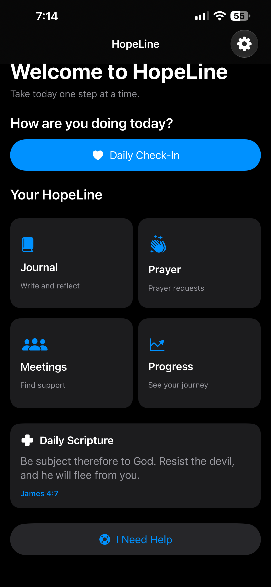
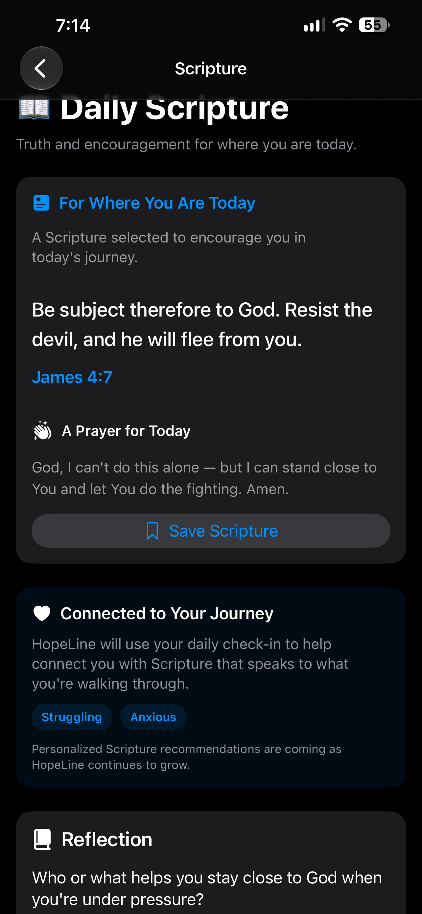
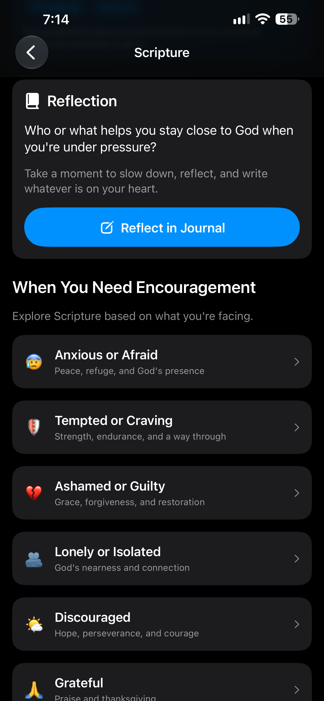

# Daily Scripture: Encouragement That Meets You Where You Are

**November 6, 2026**

**Author: Brandy Schreckhise**

---

Earlier this week, HopeLine could find you a meeting anywhere in the country. Today, it can do something just as important: it can hand you a piece of encouragement that fits the day you're having.

The new **Daily Scripture** feature is now live in the app — a rotating verse for each day, a prayer, and a reflection prompt, all backed by a real database instead of a hard-coded sample list.

  

The Home screen now carries a Daily Scripture card right below the main navigation, so encouragement is one glance away from the moment someone opens the app.

---

## 📖 How It Works

Tapping the card opens the full Scripture screen:

  

Each day has three parts:

- **The verse** — today is James 4:7: "Be subject therefore to God. Resist the devil, and he will flee from you."
- **A prayer** — a short, honest prayer written to go with the verse
- **A reflection prompt** — a question to sit with, like "Who or what helps you stay close to God when you're under pressure?"

The verses rotate through a **30-day cycle**, and there's a "Save Scripture" button so a verse that matters today can be kept for later.

The content lives in a `daily_scriptures` table in HopeLine's Supabase database, and the app picks the day's verse using the day of the year — no manual scheduling, no app update needed to change a verse.

---

## 🗂️ Scripture for What You're Facing

The daily verse is only half the feature. The screen also includes a section called **"When You Need Encouragement"** — six themes that meet specific moments in recovery:

  

- 😰 **Anxious or Afraid** — peace, refuge, and God's presence
- 🛡️ **Tempted or Craving** — strength, endurance, and a way through
- 💔 **Ashamed or Guilty** — grace, forgiveness, and restoration
- 👥 **Lonely or Isolated** — God's nearness and connection
- 🌤️ **Discouraged** — hope, perseverance, and courage
- 🙏 **Grateful** — praise and thanksgiving

Each theme is backed by ten verses in the `scripture_references` table — 60 verses total, and the list can grow at any time by adding rows to the database. Tapping a theme pulls up its verses, each with its own Save and Reflect options.

The "Reflect in Journal" button pre-fills a new journal entry with the verse and reflection prompt, so writing about what a Scripture stirred up takes one tap instead of copy-and-paste.

---

## 🛠️ Built the Right Way

A few decisions from this build worth writing down:

- **Verified verse text, not AI-generated text.** The verses come from the database, seeded from a public Bible API, so every reference can be checked. That was a hard requirement from the start — the app should never paraphrase Scripture.
- **Staged development.** This feature went in one stage at a time: the data model first, then the daily verse, then themes, then saving, then the journal connection. Each stage built and ran on its own before the next one started.
- **Saved verses are private.** Row-level security on the `saved_scriptures` table means each signed-in user only ever sees their own saved verses.
- **Room for what's next.** The check-in already tags how someone is feeling — anxious, struggling, grateful. The structure is in place to eventually connect those check-ins to Scripture recommendations. That's a future stage, and it will be built carefully.

---

## ✨ Where This Leaves HopeLine

In one week, HopeLine went from sample data to 23,745 real meetings across the country, and from a static placeholder to a living Scripture feature with daily encouragement, themed verses, saved favorites, and journal integration.

The pieces are starting to talk to each other: the check-in knows how you feel, the journal holds what you write, and now the Scripture feature gives both of them a voice of encouragement to work with.

Next up: connecting them.

---

## Navigation

- ← Previous post: [From Sample Data to 23,745 Real Meetings](./2026-11-05.md)
- → Next post: [A Settings Screen That Grows With HopeLine](./2026-11-11.md)
- [Back to the Blog Index](../index.md)

---

**Brandy Schreckhise**  
**Full Sail University – Software Development**
