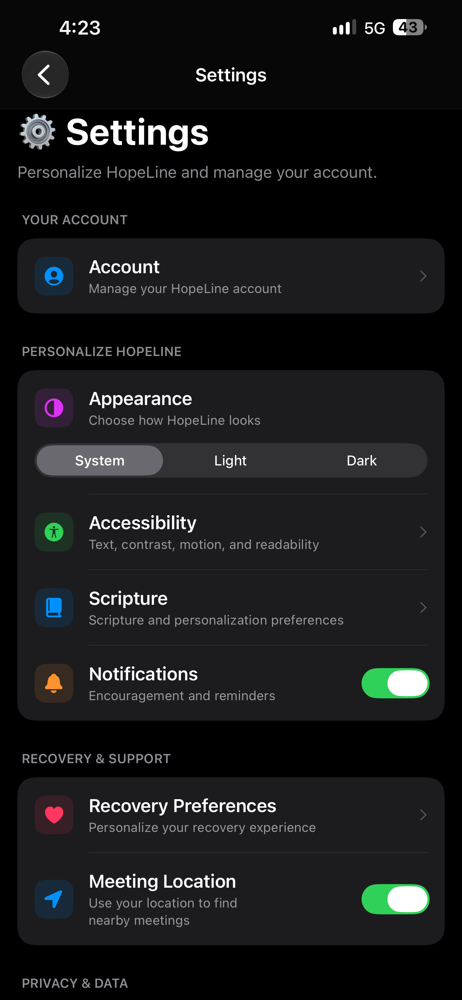
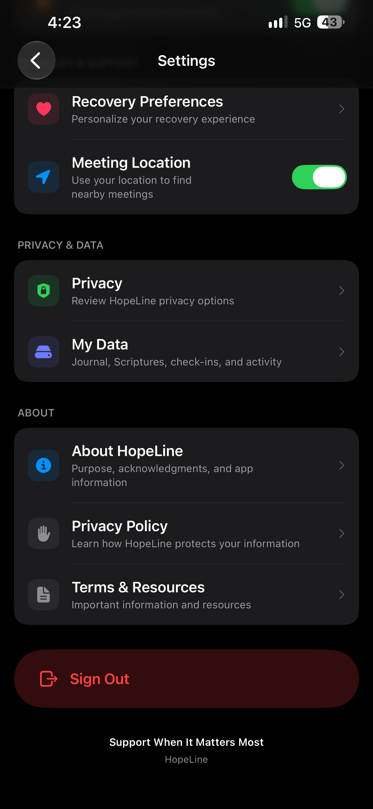
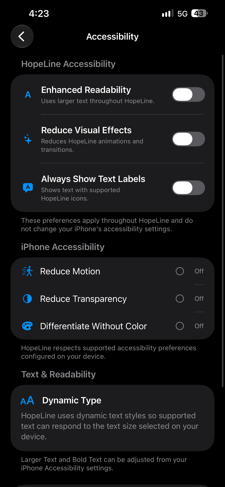

# A Settings Screen That Grows With HopeLine

**November 11, 2026**

**Author: Brandy Schreckhise**

---

The last post ended with the Daily Scripture feature working end to end. Since then, two things happened: the Scripture features got their final testing pass, and HopeLine got something it has never had before — a real Settings screen.

Both are worth writing about.

---

## ✅ Wrapping Up the Scripture Feature

First, the finish line for the Scripture build: **Save Scripture** and **Reflect in Journal** were tested and confirmed working.

- **Save Scripture** now persists to the `saved_scriptures` table, protected by row-level security so every user only ever sees their own saved verses.
- **Reflect in Journal** pre-fills a new journal entry with the verse and the reflection prompt, so writing about a Scripture takes one tap.

With that, every stage of the Scripture feature — daily verses, themed collections, saving, and journal integration — is live in the app. The only piece left is AI-assisted recommendations, which is deliberately on hold for now.

With the data layer settled, I also cleaned the repo up: the SQL migration files that had already been run against the database were removed from the project, since they had served their purpose.

---

## ⚙️ A Real Settings Screen

The bigger project this week was the Settings screen. HopeLine's Home screen has had a gear button from the start — until now, it did nothing.

  

The new screen is organized into five sections:

- **Your Account** — account management
- **Personalize HopeLine** — Appearance, Accessibility, Scripture, and Notifications
- **Recovery & Support** — Recovery Preferences and Meeting Location
- **Privacy & Data** — Privacy and My Data
- **About** — app information, Privacy Policy, and Terms & Resources

  

Several rows are honest placeholders — Account, Privacy, and Recovery Preferences show a friendly "coming soon" screen rather than pretending to be finished. The structure is in place for each feature to plug into.

---

## 🎨 Appearance Settings

The first working preference is Appearance: a segmented control with **System, Light, and Dark**.

The choice is saved to the device with `@AppStorage` and applied at the app's root view using `preferredColorScheme`, which is the pattern Apple intends for this. It persists across launches, and the System option correctly defers to whatever the iPhone is set to.

---

## ♿ An Accessibility-First Approach

The screen I'm proudest of is Accessibility — it might be the most thoughtful thing in the app so far.

  

It's split into two halves on purpose:

**HopeLine Accessibility** — three in-app toggles that work throughout the app right now:

- **Enhanced Readability** — larger text everywhere in HopeLine
- **Reduce Visual Effects** — reduces animations and transitions
- **Always Show Text Labels** — shows text alongside supported icons

**iPhone Accessibility** — read-only status rows that show whether the device itself has Reduce Motion, Reduce Transparency, or Differentiate Without Color turned on, so users can see their system settings reflected without leaving the app.

The in-app toggles are implemented as custom SwiftUI environment values applied at the root of the app, which means any view in HopeLine can read them and respond. The screen also documents HopeLine's Dynamic Type support in plain language.

For a recovery support app, accessibility isn't a nice-to-have — it's part of the mission.

---

## 🔮 What These Settings Set Up

The Scripture section of Settings now has two toggles — **Personalized Scripture** and **Use Daily Check-In** — sitting ready for the day when those features turn on. They're the opt-in controls that will govern how Scripture connects with a user's recovery journey, and their labels already explain exactly what they'll do.

Building the Settings screen before the features arrive is deliberate: when personalization ships, the privacy controls ship with it.

---

## Navigation

- ← Previous post: [Daily Scripture: Encouragement That Meets You Where You Are](./2026-11-06.md)
- [Back to the Blog Index](../index.md)

---

**Brandy Schreckhise**  
**Full Sail University – Software Development**
