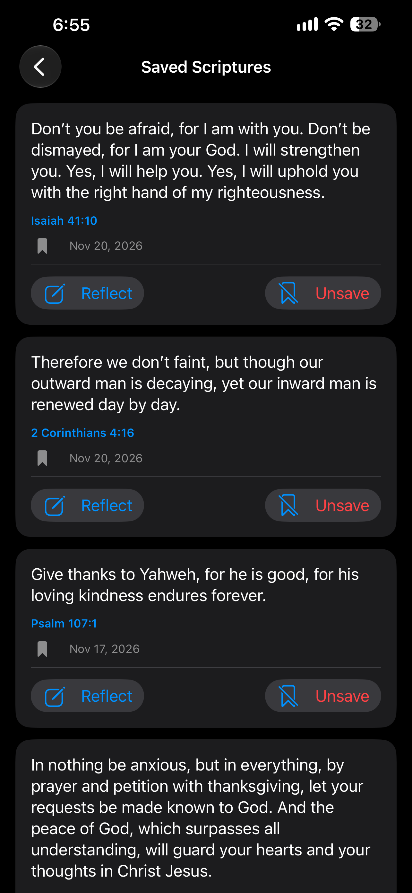
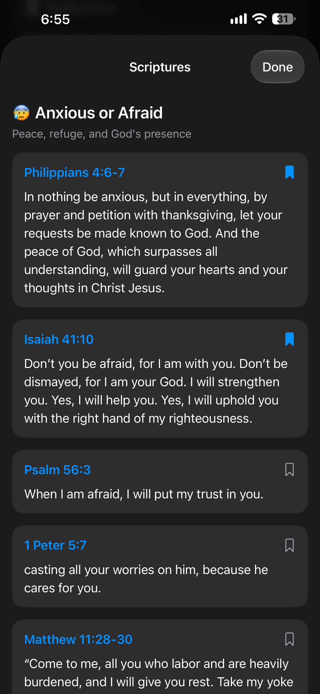
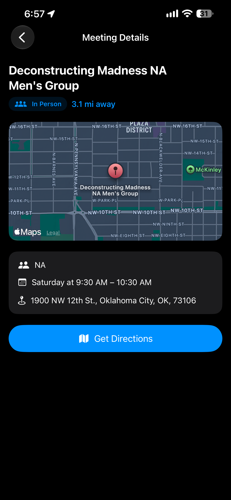
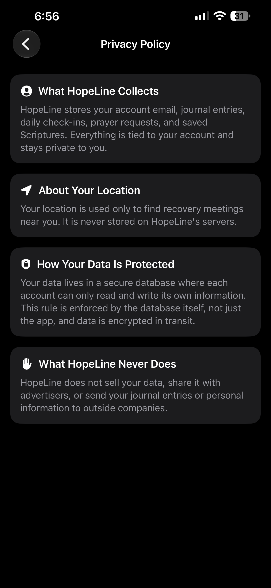
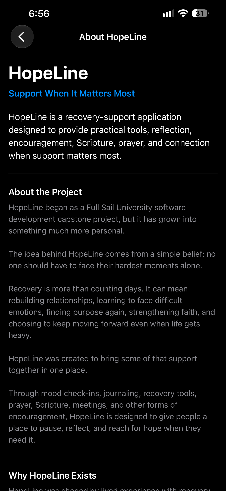
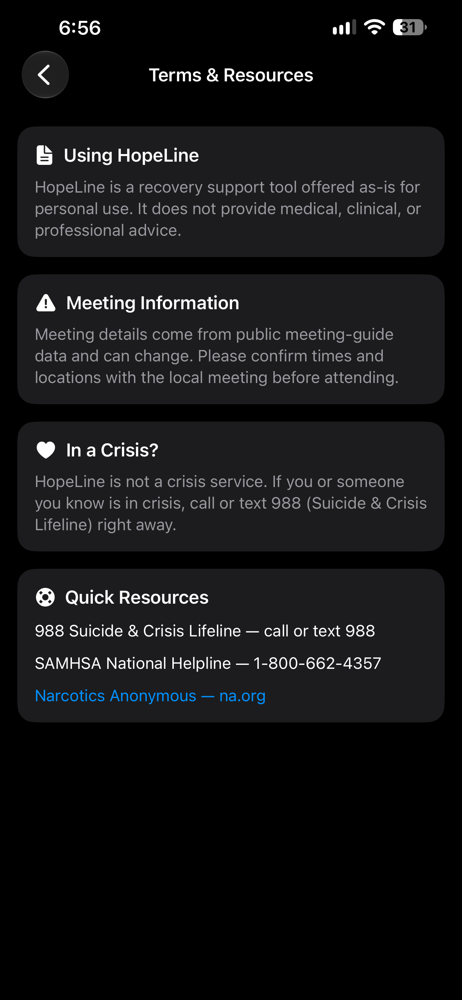

# Sprint Complete: Four Features and a Mystery

**November 20, 2026**

**Author: Brandy Schreckhise**

---

Last week was a planning week. This week was the payoff: the entire Week 4 sprint — 44 story points across four items — shipped, tested, and pushed. The Saved Scriptures list, live My Data counts, the meeting detail screen, and the Privacy Policy and Terms screens are all in the app now.

But the week will be remembered for something that wasn't on the sprint board at all: a bug that looked like a database problem, behaved like a ghost, and turned out to be neither.

Here's the week in review.

---

## 🔖 The Saved Scriptures List

The sprint started with the Saved Scriptures list — the screen in Settings where every verse you've saved lives together.

The list loads straight from the database, newest first. Each verse shows its reference, text, and the date it was saved. From there you can reflect on it in the Journal or remove it — either with an Unsave button or a swipe, whichever feels natural.

It also handles every state honestly: a loading view while it fetches, a friendly empty state when you haven't saved anything yet, and a clear error message with a retry button if something goes wrong. A list screen is only as good as its worst moment, so the worst moments got designed too.

  

---

## 🔍 The Mystery of the Disappearing Verse

Then the bug reports started.

A themed Scripture I saved disappeared when I left the theme section. The daily Scripture held onto its saved state. And nothing — nothing — was appearing in the Saved Scriptures list, even though the saves were clearly working.

What followed was the best debugging session of the capstone so far, and it went something like this:

**Suspect one: the data.** Queried the database directly. Both saves were sitting right there in the table, attached to the right accounts. Not the data.

**Suspect two: the security rules.** Row Level Security — the database rules that keep every user's data private — was the obvious suspect, because RLS failures are *silent*: the query succeeds, it just quietly returns zero rows. Pulled the policy definitions. All three policies (view, save, remove) existed and looked correct. Re-ran the exact query the app runs, signed in as the test account. The verse came back. Not the security rules.

**Suspect three: the app.** The code paths all checked out. Inserts worked. Reads worked. Everything worked — except in the app it didn't.

Then the real culprit revealed itself: **the API key**. Mid-testing — literally between one query and the next — Supabase started rejecting the app's anon key. Three straight "Invalid API key" responses, while the newer-format service key worked fine. Supabase has been sunsetting the legacy API keys, and ours got cut off *while we were testing against it*. Some requests were still getting through on the old key while others were being refused, which is exactly why the app behaved like a ghost: saves succeeded, reads failed, and nothing looked wrong anywhere.

One new publishable key in the app's config later, and everything — everything — worked.

The lesson is one every developer learns eventually: when every layer looks correct, start questioning the layer you've been assuming. The database was innocent the whole time. The code was innocent the whole time. The infrastructure underneath them just changed the rules mid-game.

---

## 📑 Save Bookmarks for Theme Scriptures

The mystery had a companion bug that turned out to be much simpler: the theme section had no way to save a verse at all.

Tapping a themed Scripture only highlighted it for reflection — and that highlight was temporary state, which is why it "disappeared" when leaving the theme. The fix was a proper feature: every theme Scripture card now has a bookmark in its corner. Tap it to save the verse, tap it again to remove it. The bookmark state loads fresh from the database every time the theme opens, so what you saved is what you see — no more disappearing acts.

Saved theme verses flow straight into the Saved Scriptures list too, so everything you save lives in one place.

  

---

## 📊 My Data with Real Counts

The My Data screen used to be a placeholder — a list of categories with no numbers. Now it's live.

Journal entries, saved Scriptures, daily check-ins, and prayers shared, each with a real count for the signed-in user. The counts load independently, so if one category fails, the others still show. And the check-in count asks the database for a number instead of downloading every row — the polite way to count.

It's a small screen, but it's the first place in the app where you can see your own history at a glance: everything you've written, saved, checked in, and shared, counted up.

  

---

## 📍 The Meeting Detail Screen

The biggest build of the sprint: tapping any meeting in the meeting finder now opens a full detail screen.

Name and meeting type at the top, distance if you're searching nearby, a map with a pin on the location, the day and time range, and the full address. Online meetings get a Join button instead of directions; in-person meetings get a Get Directions button that opens Apple Maps with the route ready to go.

The detail screen shows every piece of data the database holds for a meeting — which was the completion criteria, and honestly a satisfying bar to clear: if the data exists, the user sees it.

  

---

## 🛡️ Privacy, Terms, and the Story of HopeLine

The last sprint item was the pair of screens every app needs before release: the Privacy Policy and the Terms & Resources screens, both now reachable from Settings.

The privacy policy is written in plain language: what HopeLine collects, how location is used (only for meeting search, never stored), how the database isolates each account's data, and what HopeLine will never do — sell data, share it with advertisers, or send personal information to outside companies. The terms cover the as-is disclaimer, meeting data accuracy, and a crisis note pointing to 988, alongside quick resources.

  

  

I also rewrote the About HopeLine section this week — the story behind the project, why it exists, and the mission. This one came from somewhere deeper than a sprint board. The "Why HopeLine Exists" section says it plainly: sometimes you need to write something down, sometimes you need Scripture, sometimes you need prayer — and sometimes you just need a reminder that you are not alone and your story is not over. That's the app in a paragraph.

  

---

## ✅ The Sprint, Closed

All four items — the Saved Scriptures list, My Data counts, the meeting detail screen, and Privacy/Terms — are built, tested, and pushed. Forty-four story points, done.

More than that, the week taught the kind of lesson you can't put on a board: infrastructure changes underneath you, silent failures are the hardest failures, and the answer to "everything looks right but nothing works" is to keep pulling threads until one of them unravels the whole thing.

Next up on the backlog: meeting favorites, the crisis support screen, password reset flow and possibly account management screen. The AI-assisted Scripture recommendations stay on hold by design — one deliberate step at a time.

---

## Navigation

- ← Previous post: [From Draft to Sprint: Planning Week in Review](./2026-11-13.md)
- [Back to the Blog Index](../index.md)

---

**Brandy Schreckhise**
**Full Sail University – Software Development**
