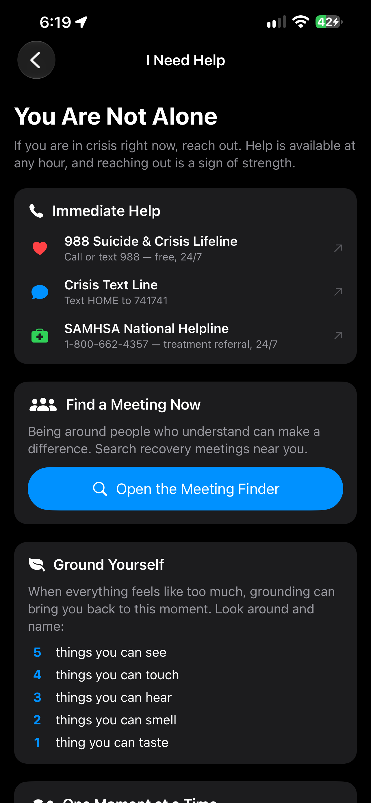
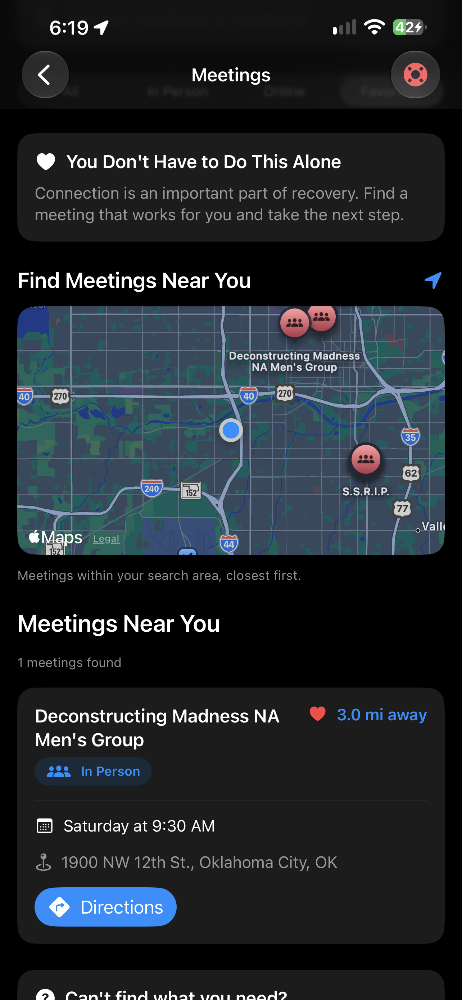

# Help Is One Tap Away: The Crisis Screen and Meeting Favorites

**November 25, 2026**

**Author: Brandy Schreckhise**

---

Sprint 5 opened this week, and the first two items off the board were the ones that matter most to the heart of the app: the "I Need Help" crisis screen and meeting favorites. Both are built, tested, and pushed.

Here's how they came together.

---

## 🆘 The "I Need Help" Screen

Every recovery app needs one feature it hopes you never have to use — and needs to be perfect the moment you do.

The new crisis screen opens straight from the big red **I Need Help** button on the Home screen. It leads with the message that matters most: **you are not alone.** From there, everything is one tap away:

- **988 Suicide & Crisis Lifeline** — call or text, free, 24/7
- **Crisis Text Line** — text HOME to 741741
- **SAMHSA National Helpline** — 1-800-662-4357 for treatment referrals

Tapping a hotline opens the phone or messages app with the number ready to go. No copy-paste, no searching, no friction when every second counts.

  

But a crisis screen shouldn't only be about crisis lines. Two more cards round it out:

- **Find a Meeting Now** — because sometimes the fastest way out of a hard moment is being around people who understand. One button jumps straight to the meeting finder.
- **Ground Yourself** — a guided 5-4-3-2-1 grounding exercise: five things you can see, four you can touch, three you can hear, two you can smell, one you can taste. A simple technique for riding out a wave without picking up.

And here's the part I'm proudest of: **the crisis screen is never more than one tap away.** Every major screen in the app — Check-In, Journal, Prayer, Scripture, and Meetings — now has a lifepreserver icon in the toolbar that opens it instantly. Wherever you are in HopeLine, help is one tap away.

---

## ❤️ Meeting Favorites

The second feature is smaller but just as personal: you can now heart a meeting.

Open any meeting's detail screen and there's a heart next to the distance. Tap it and it fills red — that meeting is saved to your account. Tap it again and it's gone.

  

Back on the meetings list, the filter bar gained a **Favorites** segment. Switch to it and you see only the meetings you've hearted — the Saturday morning group that fits your schedule, the one two miles from home, the ones that work. Each favorited meeting also gets a small red heart badge on its card so you can spot your regulars at a glance.

### Under the Hood

Favorites live in their own database table, keyed by meeting guide ID — a stable identifier that survives meeting-data syncs. That way a favorite you saved today still points at the same meeting next week even after the nationwide meeting data refreshes.

And just like everything else in HopeLine, favorites are private by design: Row Level Security policies guarantee every account can only see, save, and remove its own favorites. If you're signed out, the app tells you plainly — "Sign in to save favorite meetings to your account" — instead of failing silently.

One honest scope note: the Favorites filter shows favorited meetings from the meetings currently loaded near you. A favorite on the other side of the state won't appear until you search near it. That's the right trade for now, and it keeps the feature simple and fast.

---

## 🐛 The Bug That Almost Wasn't

The sprint had one small hiccup: the first build failed with "no member meetingGuideId" in three places. The culprit? A property named `meetingGuideID` — capital ID — being referenced with a lowercase *d*. Five references, one spelling fix, clean build.

Type-safe languages catch the silliest bugs sometimes. That's not a complaint.

---

## ✅ Where the Sprint Stands

Two of the four Sprint 5 items are done and pushed — the crisis screen and meeting favorites, 32 of the sprint's story points. The remaining two, the account management screen and the password reset flow, are in progress and will be finished by the end of the week after Thanks Giving.

The AI-assisted Scripture recommendations stay on hold by design, same as before.

Next up: finishing the sprint, and then the blog post recapping whatever the plan is for next week.

---

## Navigation

- ← Previous post: [Sprint Complete: Four Features and a Mystery](./2026-11-20.md)
- [Back to the Blog Index](../index.md)

---

**Brandy Schreckhise**
**Full Sail University – Software Development**
