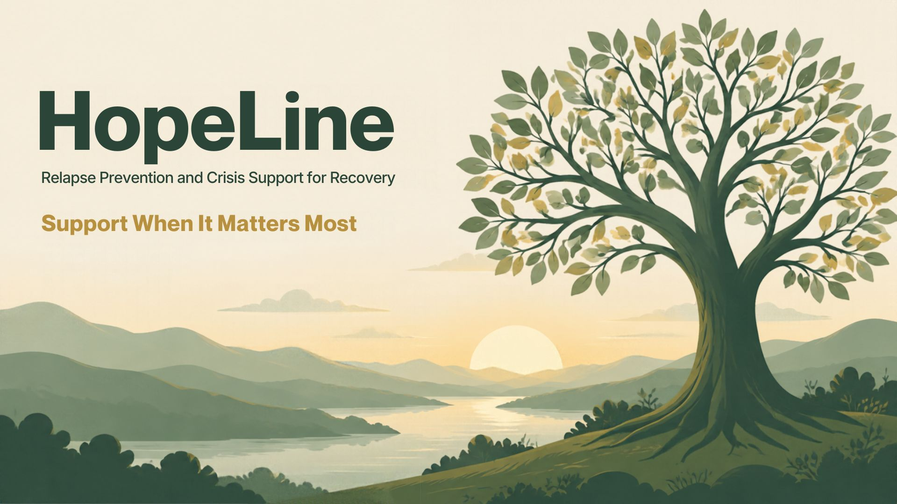

# HopeLine Development Blog

*Support When It Matters Most*

Welcome to the official development blog for **HopeLine**, a mobile application focused on recovery support, mental health resources, and faith-based encouragement.

## Navigation

- [October 27, 2026 - Starting the Journey: Why HopeLine Matters](./blog/2026-10-27.md)
- [October 31, 2026 - Learning the Workflow: Git, GitHub, and HopeLine](./blog/2026-10-31.md)
- [November 3, 2026 - Building Reflection and Community into HopeLine](./blog/2026-11-03.md)
- [November 4, 2026 - Building a Location-Aware Recovery Meeting Finder](./blog/2026-11-04.md)
- [November 5, 2026 - From Sample Data to 23,745 Real Meetings](./blog/2026-11-05.md)
- [November 6, 2026 - Daily Scripture: Encouragement That Meets You Where You Are](./blog/2026-11-06.md)
---

## About the Project

HopeLine is a relapse-prevention and crisis-support application designed to help individuals navigate moments of emotional distress, isolation, and recovery challenges through practical tools, scripture encouragement, and community resources.

The application was inspired by my personal recovery journey and my desire to combine technology, faith, and support into a tool that can make a meaningful difference in people's lives.

As this project develops, this blog will document the design decisions, technical challenges, solutions, milestones, and lessons learned throughout the capstone development process.

---

**Author:** Brandy Schreckhise  
**Full Sail University – Software Development**
